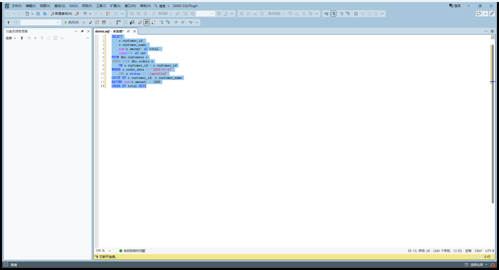
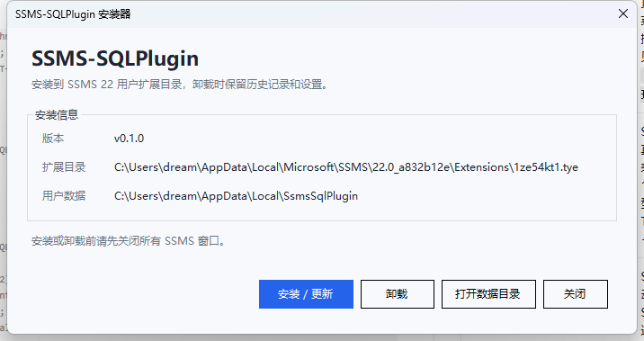
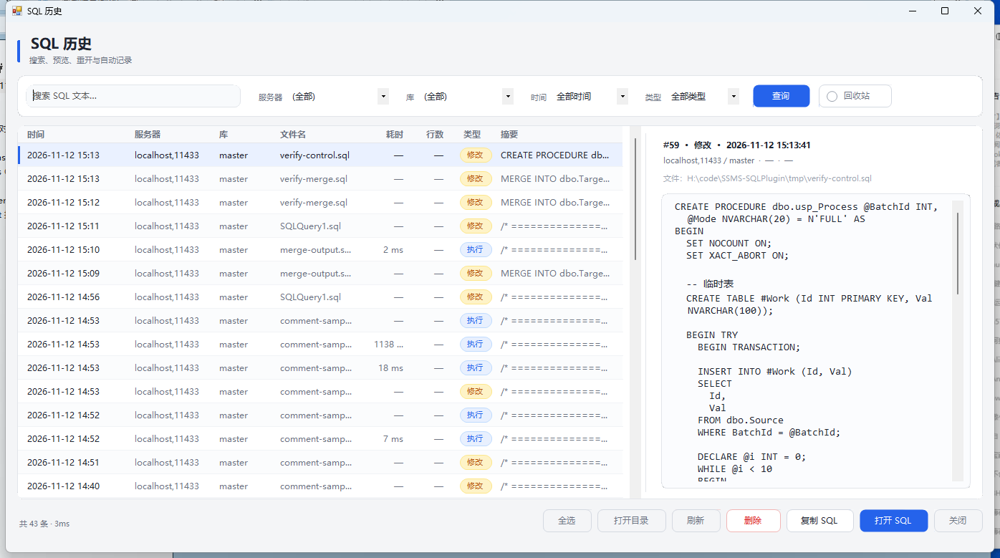
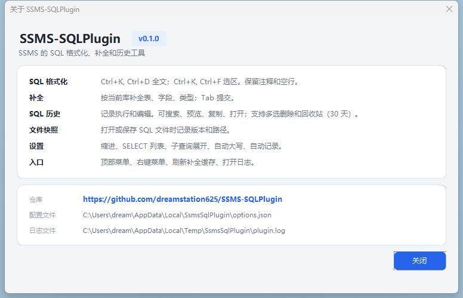

<div align="center">

# SSMS-SQLPlugin

在 SSMS 22 里格式化 SQL、补全表字段、回看执行历史。

[](#兼容性)
[](#兼容性)
[](#兼容性)
[](https://github.com/dreamstation625/SSMS-SQLPlugin)
[](https://github.com/dreamstation625/SSMS-SQLPlugin/releases)
[](https://ifdian.net/a/dream_craft)

</div>

<p align="center">
  
</p>

## 功能

| 功能 | 说明 |
|---|---|
| SQL 格式化 | <kbd>Ctrl</kbd>+<kbd>K</kbd>, <kbd>Ctrl</kbd>+<kbd>D</kbd> 全文；<kbd>Ctrl</kbd>+<kbd>K</kbd>, <kbd>Ctrl</kbd>+<kbd>F</kbd> 选区。保留注释和空行。 |
| 补全 | 读取当前数据库的表、字段和类型，<kbd>Tab</kbd> 提交。 |
| SQL 历史 | 记录执行和编辑。支持搜索、筛选、预览、复制、重开、多选删除和 30 天回收站。 |
| 文件快照 | 打开或保存 `.sql` 文件时记录版本和路径。 |
| 设置 | 缩进、SELECT 列表、子查询展开、空格后关键字自动大写、自动记录。 |
| 语言与主题 | 中英双语，默认跟随系统，可在顶部菜单「语言」切换；窗口跟随 SSMS 浅色/深色主题。 |
| 首次启动 | 显示功能介绍、GitHub 仓库和爱发电入口；可勾选不再显示。 |
| 入口 | 顶部菜单、编辑器右键菜单、刷新补全缓存、打开日志、检查更新。 |

## 安装

1. 到 [Releases](https://github.com/dreamstation625/SSMS-SQLPlugin/releases) 下载 `SSMS-SQLPlugin-Setup.exe`。
2. 关闭所有 SSMS 窗口。
3. 运行安装器，点「安装 / 更新」。
4. 启动 SSMS，顶部菜单会出现 `SSMS-SQLPlugin`。

安装器会自动检测 SSMS 21 / 22，给每个已安装版本投放对应扩展，并调用该版本自带的 `VSIXInstaller.exe` 注册。调用期间会显示遮罩和进度条，请不要重复点击或关闭窗口。如果 360 等安全软件提示 VSIXInstaller 要修改 `SSMS.exe.config`，请按提示放行。

<p align="center">
  
</p>

卸载：Windows「设置 → 应用」里卸载，或运行 `%LOCALAPPDATA%\SsmsSqlPlugin\Installer\SSMS-SQLPlugin-Setup.exe`。卸载会保留历史记录和设置。

> 当前构建未做代码签名，SmartScreen 可能提示未知发布者。确认文件来自本项目 Releases 后再继续。

## 使用

| 操作 | 方式 |
|---|---|
| 格式化全文 | <kbd>Ctrl</kbd>+<kbd>K</kbd>, <kbd>Ctrl</kbd>+<kbd>D</kbd> |
| 格式化选区 | <kbd>Ctrl</kbd>+<kbd>K</kbd>, <kbd>Ctrl</kbd>+<kbd>F</kbd> |
| 打开历史 | 顶部菜单「SQL 历史...」 |
| 全选历史 | 列表内 <kbd>Ctrl</kbd>+<kbd>A</kbd> 或「全选」 |
| 批量删除/恢复 | 选中后按 <kbd>Delete</kbd>，或点「删除 / 恢复」 |
| 复制 SQL | <kbd>Ctrl</kbd>+<kbd>C</kbd> 或「复制 SQL」 |
| 重开 SQL | 双击记录或「打开 SQL」 |

<p align="center">
  
  
</p>

## 兼容性

| 项 | 要求 |
|---|---|
| SSMS | 21.x / 22.x |
| 系统 | Windows 10 / 11 x64 |
| 运行时 | .NET Framework 4.8 |

SSMS 20 尚未适配。

## 数据位置

| 内容 | 路径 |
|---|---|
| 设置 | `%LOCALAPPDATA%\SsmsSqlPlugin\options.json` |
| 自动记录配置 | `%LOCALAPPDATA%\SsmsSqlPlugin\autosave.cfg` |
| 历史数据库 | `%LOCALAPPDATA%\SsmsSqlPlugin\data.db` |
| 日志 | `%TEMP%\SsmsSqlPlugin\plugin.log` |

数据只保存在本机，不上传网络。

<details>
<summary>从源码构建</summary>

环境：Windows、.NET SDK 10、Python 3.12。

```bash
# VSIX + 安装器
python src/SsmsSqlPlugin.Vsix/build.py --no-deploy --installer
```

产物：

- `src/SsmsSqlPlugin.Vsix/dist/SSMS-SQLPlugin.vsix`
- `src/SsmsSqlPlugin.Vsix/dist/SSMS-SQLPlugin-Setup.exe`

开发部署到本机 SSMS（先关闭 SSMS）：

```bash
python src/SsmsSqlPlugin.Vsix/build.py
```

</details>

<details>
<summary>回归测试</summary>

```bash
dotnet run --project tools/FormatCli -- --quiet
dotnet run --project tools/FormatCli -- --dir tools/FormatCli/Corpus
```

第一组是内置格式化用例，第二组覆盖 CTE、MERGE、控制流、DDL、注释、Unicode 等复杂 SQL。

</details>

## 已知限制

- 函数名大小写、别名纵向对齐未做。
- 游标 `DECLARE ... FOR SELECT` 的 body 未额外缩进。
- SSMS 20 暂不支持。
- Release 产物未签名。

## 支持

<a href="https://ifdian.net/a/dream_craft"></a>

本项目已入驻爱发电，欢迎赞助支持：<https://ifdian.net/a/dream_craft>

## 免责声明

本项目是第三方 SSMS 扩展，与 Microsoft 无关，不受 Microsoft 支持。

格式化会修改编辑器中的 SQL 文本，可用 <kbd>Ctrl</kbd>+<kbd>Z</kbd> 撤销。自动记录会在本机保存 SQL 内容。请在符合所在组织安全要求的前提下使用。

---

本项目由 WorkBuddy 和 Qoder 完成。
