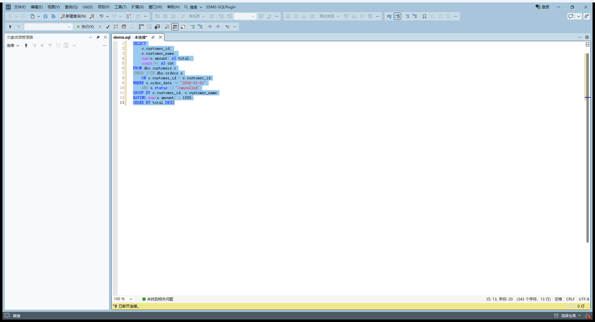

# SSMS 接入实现（P1.5）

> 2026-11-11 ｜ 代码：`src/SsmsSqlPlugin.Vsix` ｜ 2041 行
> 目标：把排版引擎接进 SSMS，提供顶部二级菜单、编辑器右键菜单、快捷键三个入口。

---

## 1. 最终效果

### 1.1 顶部菜单（用户明确要求）

菜单栏最右侧多一个 `SSMS-SQLPlugin`：

```
文件  编辑  视图  查询  项目  工具  扩展  窗口  帮助  搜索…  SSMS-SQLPlugin
                                                                │
  ├─ 格式化 SQL              Ctrl+K, Ctrl+D
  ├──────────────────────
  ├─ 格式化选项  ▸
  │    ├─ ✓ 缩进 2 空格
  │    ├─ ✓ 缩进 4 空格（当前）
  │    ├──────────────────
  │    ├─ ✓ 关键字大写
  │    ├─ ✓ SELECT 每列一行
  │    └─ ✓ 展开子查询
  ├──────────────────────
  ├─ 打开日志
  └─ 关于 SSMS-SQLPlugin
```

勾选项表示当前生效值；改完立即重建菜单刷新勾。

### 1.2 编辑器右键菜单

`代码窗口` 上下文菜单末尾追加：

```
──────────────────────
格式化 SQL
```

### 1.3 快捷键

`Ctrl+K, Ctrl+D`（VS 传统"设置文档格式"键序）在 SQL 编辑器里触发格式化。

---

## 2. 模块结构

| 文件 | 职责 | 行数 |
|---|---|---|
| `SqlPluginPackage.cs` | 包入口：注入 UI、挂过滤器、动作实现、自检 | 474 |
| `Menus/CommandBarInjector.cs` | CommandBars 注入公共逻辑 + MenuEntry 模型 | 300 |
| `Menus/TopLevelMenu.cs` | 顶部一级菜单 + 二级"格式化选项" | 281 |
| `Menus/EditorContextMenu.cs` | 编辑器右键菜单 | 150 |
| `Editor/FormatExecutor.cs` | 读编辑器 → 格式化 → 写回 + 选区恢复 | 240 |
| `Editor/EditorLocator.cs` | 取活动 IVsTextView + 判断是否 SQL 编辑器 | 170 |
| `Editor/EditorCommandFilter.cs` | 命令链过滤器：快捷键 + 右键菜单保活 | 175 |
| `Editor/FormatOptionsStore.cs` | 选项值对象 + JSON 持久化 | 250 |
| `Infrastructure/Log.cs` | 日志（写 %TEMP%） | 95 |

---

## 3. 四个必须记住的坑

### 3.1 pkgdef 里**不能有 `;` 注释**

```ini
[$RootKey$\Packages\{0a88c9e6-...}]
@="SSMS-SQLPlugin"
...
; SSMS 自身 UI 上下文（d114938f）   ← ❌ 这一行会让整个文件解析失败
[$RootKey$\AutoLoadPackages\{d114938f-...}]
```

只要出现一行 `; 说明`，Shell 的 pkgdef 合并器就**整段放弃**，
`[$RootKey$\Packages\{GUID}]` 根本没进 `privateregistry.bin`
→ 包不注册 → 不加载 → **零日志、零报错、菜单不出现**。

**这是本项目最难查的一个坑**：本来一切正常，我为了写注释加了几行 `;`，
之后连续多轮验证都是"SSMS 活着、日志一个字没有、菜单不出现"，
排查了缓存、目录名、文件版本、manifest 全都对，最后是搜
`privateregistry.bin` 里有没有包 GUID 才发现根本没合并。

**判别方法**：

```python
data = open(r'%LOCALAPPDATA%\Microsoft\SSMS\22.0_xxx\privateregistry.bin','rb').read()
print(data.find('0a88c9e6-4e5f-4d80-9f6a-f88e3f8270bb'.encode('utf-16-le')))
# -1 = 没合并成功，包不会加载
```

`build.py` 已经加了 `verify_pkgdef()` 主动拦截：检测到注释行直接报错退出。

### 3.2 `CommandBarPopup` **不能**强转成 `CommandBar`

```csharp
// ❌ 抛 InvalidCastException: 无法将类型为 "_Marshaler" 的对象强制转换为 "CommandBar"
var popup = (CommandBarPopup)menuBar.Controls.Add(...);
Populate((CommandBar)popup, children);

// ✅ 直接传 popup.Controls
var popup = menuBar.Controls.Add(...) as CommandBarPopup;
Populate(popup.Controls, children);
```

原因：SSMS 22.11 返回的是 `_Marshaler` 动态包装，**只有拿到的那个接口视图能转**。
`c as CommandBarPopup` 成功，但同一个对象 `as CommandBar` 就失败。

所以递归注入的签名要用 `CommandBarControls` 而不是 `CommandBar`：

```csharp
public static int Populate(CommandBarControls controls, IList<MenuEntry> entries)
```

### 3.3 扩展目录名不能自己起

```
%LOCALAPPDATA%\Microsoft\SSMS\22.0_a832b12e\Extensions\
  ├─ 1ze54kt1.tye          ← Shell 生成的格式：8 字符 + "." + 3 字符
  └─ ssmssqlplugin.dev     ← ❌ 不扫，包不加载、零日志、不报错
```

目录名必须是 Shell 自己生成的随机 ID 形式。自己起名字（哪怕是合法路径）
会导致**包完全不加载且毫无提示**——比 pkgdef 写错还难查。

部署时要么复用已在的那个目录，要么沿用探测阶段生成过的 ID。

### 3.4 不要用 `Marshal.GetIUnknownForObject` 做去重键

```csharp
// ❌ 每次调用 AddRef，异常路径漏 Release 就失衡；不同 RCW 实例还可能哈希冲突
IntPtr key = Marshal.GetIUnknownForObject(view);
try { ... } finally { Marshal.Release(key); }

// ✅ 用对象身份哈希
int key = RuntimeHelpers.GetHashCode(view);
```

这个坑当时表现成"SSMS 启动几十秒后自己退出"，排查了很久才发现是引用计数失衡。

---

## 3.5 部署必须同时做三件事

```python
# ① 复制文件
# ② touch 标记
os.utime(extensions_configurationchanged, None)
# ③ 删掉元数据缓存（只做②不一定够，实测遇到过"文件换了标记也刷了仍不加载"）
os.remove("ExtensionMetadata2.0.mpack")
os.remove("ExtensionMetadataCache.mpack")
```

`build.py` 已全部自动做。

---

## 4. 写回与撤销

### 4.1 用 `ReplaceLines` 而不是先删后插

`IVsTextLines.ReplaceLines` 一次调用 = **一个撤销单元**。
用户按一次 Ctrl+Z 就整体回退，体验正确。

先 `DeleteLines` 再 `InsertLines` 会产生两个撤销步骤，需要按两次。

### 4.2 第 5 个参数是 `IntPtr` 不是 `string`

```csharp
// ❌ CS1503: 参数 5: 无法从"string"转换为"System.IntPtr"
buffer.ReplaceLines(sl, sc, el, ec, text, text.Length, null);

// ✅ COM 的 LPCOLESTR，必须自己分配/释放
IntPtr p = Marshal.StringToCoTaskMemAuto(text);
try {
    buffer.ReplaceLines(sl, sc, el, ec, p, text.Length, null);
} finally {
    Marshal.FreeCoTaskMem(p);
}
```

### 4.3 格式化只改缓冲区，不改文件

用户仍需自己 Ctrl+S。这是正确行为：
- 可以 Ctrl+Z 后悔
- 不会偷偷改磁盘文件

---

## 5. 快捷键怎么生效的

`Ctrl+K Ctrl+D` 在 VS 里最终派发 `CMDSETID_StandardCommandSet97` 的
`FormatDocument (0x0002)`。

我们挂在编辑器命令链上：

```csharp
vsView.AddCommandFilter(filter, out next);   // IVsTextView 的命令过滤器
```

过滤器里看到 `FormatDocument` 且当前是 SQL 编辑器，就换成自己的格式化并返回 `S_OK`
（吞掉命令，不往下传）。

判据 `IsSqlView` 靠**内容类型名**（含 "SQL"）+ `.sql` 扩展名双保险，
不硬编码编辑器 GUID（那玩意儿不是公开常量，随版本变）。

---

## 6. 验证方法：日志自检

UI 自动点击（UIA / 模拟鼠标）在 SSMS 上不可靠 —— 窗口层级、前台锁、
"连接到服务器"对话框都会干扰。**唯一可靠的验证是日志。**

设置了环境变量 `SQLKIT_SELFTEST=1` 时，包初始化后会跑一遍全链路并写日志：

```bash
SQLKIT_SELFTEST=1 SSMS.exe path\to\test.sql
```

日志在 `%TEMP%\SsmsSqlPlugin\plugin.log`，判定项：

```
[自检] 改成缩进 2 后回读 = 2 -> PASS
[自检] 配置文件已落盘: ...\options.json -> PASS
[自检] 引擎调用 -> PASS
[自检] 活动 SQL 视图 = 有
[自检] FormatExecutor: changed=True error=False msg=已格式化。
[自检] 编辑器格式化 -> PASS
```

这个开关留着：以后改菜单/回调，跑一次就知道链路有没有断。

---

## 7. 实测验收证据（2026-11-11 16:48）



上图：菜单栏最右 `SSMS-SQLPlugin`；编辑器内 12 行格式化结果，且全文保持选中
（说明选区恢复也在工作）。

### 7.1 菜单结构被 Shell 接受

```
INFO  一级菜单已创建: SSMS-SQLPlugin
INFO  顶部菜单已安装：SSMS-SQLPlugin，子项 6 个，菜单栏现有 21 个顶级菜单
INFO    └─ [SSMS-SQLPlugin] 子项 6 个
INFO       [1] ITEM  cap="格式化 SQL	Ctrl+K, Ctrl+D" visible=True tag=SsmsSqlPlugin:Format
INFO       [3] POPUP cap="格式化选项" visible=True tag=SsmsSqlPlugin:Options
INFO       └─ [格式化选项] 子项 6 个
INFO          [1] ITEM  cap="缩进 2 空格" visible=True tag=SsmsSqlPlugin:Indent2
INFO          [4] ITEM  cap="关键字大写" visible=True tag=SsmsSqlPlugin:Upper
INFO          [5] ITEM  cap="SELECT 每列一行" visible=True tag=SsmsSqlPlugin:Vertical
INFO          [6] ITEM  cap="展开子查询" visible=True tag=SsmsSqlPlugin:Subquery
INFO       [6] ITEM  cap="关于 SSMS-SQLPlugin" visible=True tag=SsmsSqlPlugin:About
INFO  右键菜单：命中 "Code Window"，现有子项 26 个
INFO  右键菜单：已注入「格式化 SQL」
INFO  命令过滤器已挂 hr=0x00000000 next=CommandChainNode
```

回读的 `cap` / `Visible` 都是 COM 对象上的真实值，不是我们传进去的字符串 ——
说明 Shell 收下了。

### 7.2 菜单点击回调真的跑通

```
INFO  菜单触发: 格式化 SQL	Ctrl+K, Ctrl+D
INFO  格式化范围 0:0 → 1:0，长度 93
INFO  格式化结果: changed=True error=False msg=已格式化。
```

这条是关键：证明菜单项不是只有个壳子。

### 7.3 屏上可见 + 内容正确

截图（`tmp/verify/FINAL.png`）：菜单栏最右侧 `SSMS-SQLPlugin`；
编辑器里 12 行格式化结果：

```sql
SELECT
    c.customer_id,
    c.customer_name,
    sum(o.amount) AS total,
    count(*) AS cnt
FROM dbo.customers c
INNER JOIN dbo.orders o
    ON o.customer_id = c.customer_id
WHERE o.order_date >= '2026-01-01'
    AND o.status <> 'cancelled'
GROUP BY c.customer_id, c.customer_name
HAVING sum(o.amount) > 1000
ORDER BY total DESC
```

---

## 8. 部署

```bash
cd src/SsmsSqlPlugin.Vsix
python build.py            # 构建 + 打包 vsix + 部署 + 刷新标记
python build.py --no-deploy  # 只构建打包
```

产物：`dist/SSMS-SQLPlugin.vsix`（43 KB）。

**部署铁律**：装完必须 `touch extensions.configurationchanged`，
否则 Shell 用旧缓存、包静默不加载。`build.py` 已自动做。

**装之前先杀干净所有 `SSMS.exe`**，否则文件被占用、部署的是半旧版本。

---

## 9. 已知限制

| 项 | 说明 |
|---|---|
| 快捷键依赖默认键绑定 | 若用户把 Ctrl+K Ctrl+D 改掉了，拦截就失效；顶部菜单和右键菜单不受影响 |
| 勾选状态需重建菜单 | CommandBars 的按钮样式只在创建时定，Shell 不回调 QueryStatus。改选项后重建整个菜单来刷新（代价很小） |
| 右键菜单需要保活 | Shell 会重建编辑器上下文菜单，靠命令过滤器每 2 秒检查一次补回来 |
| 单实例假设 | 多开 SSMS 时各进程各装一套菜单，日志会写到同一个文件（追加模式，可能交错） |
